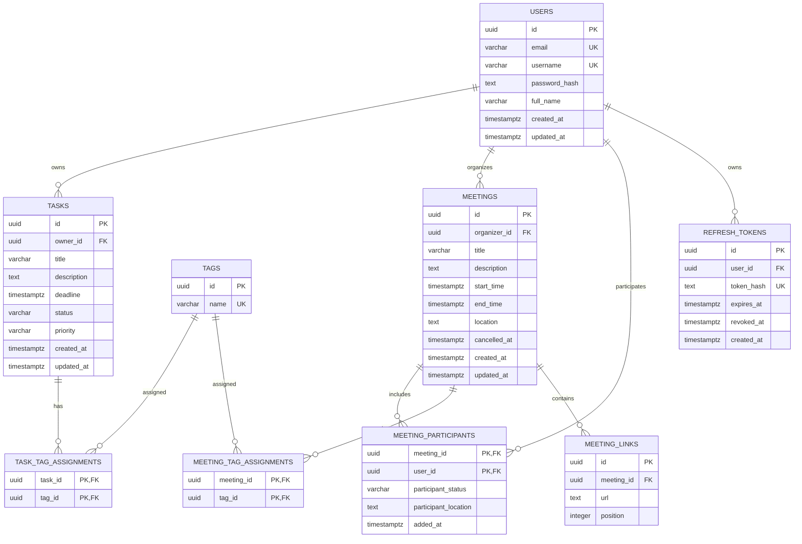

# Проект схемы PostgreSQL для TaskTracker

> **Статус: черновик на проверку.** Схема спроектирована по предоставленной спецификации API. Неоднозначные решения перечислены в конце; до подтверждения их следует считать допущениями, а не окончательными бизнес-правилами.

## 1. Принципы проектирования

- Идентификаторы API типа `Guid` хранятся как `UUID`.
- Временные значения ISO 8601 хранятся как `TIMESTAMPTZ`, чтобы сохранять момент времени независимо от часового пояса клиента.
- Повторяющиеся списки (`tags`, `links`, `participants`) вынесены в отдельные таблицы и таблицы связей.
- Теги задач и встреч используют единый справочник `tags`.
- Теги задач и встреч используют единый справочник `tags`.
- У задач есть владелец, поскольку API предусматривает запрет на изменение чужой задачи (`403 Forbidden`). Задачи не общие: если несколько участников выполняют похожую задачу, каждому создаётся отдельная запись `tasks` со своим `id` и `owner_id`.
- У встречи есть организатор и участники. Организатор подразумевается описанием сценариев, но поле организатора прямо не показано в DTO.
- Содержимое `pagination` вычисляется запросом и **не хранится** в базе.
- SignalR-события и сообщения RabbitMQ рассматриваются как транспортные события, а не как постоянные сущности. Их хранение не требуется приведёнными эндпоинтами.
- Access-токены не сохраняются в схеме: они обычно проверяются по подписи и сроку действия. Для refresh-токенов предусмотрена отдельная таблица, поскольку API поддерживает refresh и logout; способ хранения/инвалидации нужно подтвердить.
- Таблицы используют схему PostgreSQL `public`. DDL не создаёт пользователя БД и не настраивает права доступа.

## 2. Сущности и таблицы

### 2.1 `users`

**Назначение:** учётная запись, созданная через `/api/auth/register`, и идентичность пользователя для задач, встреч и авторизации.

| Столбец | Тип PostgreSQL | Ограничения | Назначение |
|---|---|---|---|
| `id` | `UUID` | PK, NOT NULL | Идентификатор пользователя |
| `email` | `VARCHAR(320)` | NOT NULL, UNIQUE | Email для входа |
| `username` | `VARCHAR(64)` | NULL, UNIQUE | Имя пользователя из профиля |
| `password_hash` | `TEXT` | NOT NULL | Хэш пароля, не исходный пароль |
| `full_name` | `VARCHAR(200)` | NOT NULL | Отображаемое имя |
| `created_at` | `TIMESTAMPTZ` | NOT NULL | Время создания записи |
| `updated_at` | `TIMESTAMPTZ` | NOT NULL | Время последнего изменения записи |

**Почему так:** регистрация и профиль относятся к одной учётной записи; отдельная таблица `profiles` и поле настроек не нужны, поскольку спецификация требует только основные поля. Email уникален как предполагаемый идентификатор входа; чувствительность к регистру и нормализация email требуют решения.

### 2.2 `refresh_tokens`

**Назначение:** учёт refresh-токенов для `/api/auth/refresh` и `/api/auth/logout`.

| Столбец | Тип PostgreSQL | Ограничения | Назначение |
|---|---|---|---|
| `id` | `UUID` | PK, NOT NULL | Идентификатор записи |
| `user_id` | `UUID` | FK → `users.id`, NOT NULL | Владелец токена |
| `token_hash` | `TEXT` | NOT NULL, UNIQUE | Хэш токена, а не открытый токен |
| `expires_at` | `TIMESTAMPTZ` | NOT NULL | Срок действия |
| `revoked_at` | `TIMESTAMPTZ` | NULL | Время отзыва; NULL означает, что отзыв не зафиксирован |
| `created_at` | `TIMESTAMPTZ` | NOT NULL | Время выдачи |

**Связь:** `users 1:N refresh_tokens`. Одна учётная запись может иметь несколько сессий/refresh-токенов. Если приложение использует stateless refresh-токены без серверного учёта, таблица может быть не нужна; это нужно уточнить.

### 2.3 `tasks`

**Назначение:** основная сущность задач для `/api/tasks`.

| Столбец | Тип PostgreSQL | Ограничения | Назначение |
|---|---|---|---|
| `id` | `UUID` | PK, NOT NULL | `taskId` |
| `owner_id` | `UUID` | FK → `users.id`, NOT NULL | Пользователь-владелец |
| `title` | `VARCHAR(300)` | NOT NULL, CHECK не пустая строка | Заголовок |
| `description` | `TEXT` | NULL | Описание |
| `deadline` | `TIMESTAMPTZ` | NULL | Дедлайн |
| `deadline_reminder_sent_at` | `TIMESTAMPTZ` | NULL | Время публикации напоминания в RabbitMQ; NULL означает, что напоминание ещё не опубликовано |
| `deadline_reminder_lease_until` | `TIMESTAMPTZ` | NULL | Время окончания временной блокировки строки Worker-ом |
| `deadline_reminder_lease_id` | `UUID` | NULL | Токен владельца lease для безопасного завершения/повтора |
| `status` | `VARCHAR(20)` | NOT NULL, CHECK из разрешённых значений | `Todo`, `InProgress`, `Done` |
| `priority` | `VARCHAR(20)` | NOT NULL, CHECK из разрешённых значений | `Low`, `Medium`, `High` |
| `created_at` | `TIMESTAMPTZ` | NOT NULL | Время создания |
| `updated_at` | `TIMESTAMPTZ` | NOT NULL | Время изменения |

**Почему так:** задача принадлежит одному пользователю, пользователь может иметь много задач (`users 1:N tasks`). Статус и приоритет хранятся как ограниченные строки, а не PostgreSQL ENUM, чтобы их было проще расширять миграцией. Значения по умолчанию для `status` и обязательность `priority` следует подтвердить.

Для выбора ближайших напоминаний используется частичный индекс `ix_tasks_deadline_reminder_due` по `(deadline, id)` для задач, которые не завершены и ещё не напоминались. Репозиторий в Shared выбирает небольшую пачку кандидатов, затем условно обновляет их lease одним EF Core `ExecuteUpdate`; при одновременной обработке реплик условие lease позволяет захватить каждую строку только одной реплике.

### 2.4 `tags`

**Назначение:** единый справочник тегов, используемых как задачами, так и встречами.

| Столбец | Тип PostgreSQL | Ограничения | Назначение |
|---|---|---|---|
| `id` | `UUID` | PK, NOT NULL | Идентификатор тега |
| `name` | `VARCHAR(100)` | NOT NULL, UNIQUE, CHECK не пустое | Отображаемое имя тега |

Теги хранятся отдельно от задач и встреч, чтобы один и тот же тег переиспользовался без дублирования. Уникальность имени глобальная для обеих сущностей; если одинаковые названия с разным регистром должны считаться одним тегом, понадобится нормализация или индекс по `lower(name)`.

### 2.5 `task_tag_assignments`

**Назначение:** связь задач и тегов.

| Столбец | Тип PostgreSQL | Ограничения | Назначение |
|---|---|---|---|
| `task_id` | `UUID` | PK (часть составного ключа), FK → `tasks.id`, NOT NULL | Задача |
| `tag_id` | `UUID` | PK (часть составного ключа), FK → `tags.id`, NOT NULL | Тег |

**Связь:** `tasks N:M tags`, реализована таблицей-связкой. Составной PK запрещает назначить один и тот же тег одной задаче несколько раз.

### 2.6 `meetings`

**Назначение:** встречи календаря.

| Столбец | Тип PostgreSQL | Ограничения | Назначение |
|---|---|---|---|
| `id` | `UUID` | PK, NOT NULL | Идентификатор встречи |
| `organizer_id` | `UUID` | FK → `users.id`, NOT NULL | Создатель/организатор |
| `title` | `VARCHAR(300)` | NOT NULL, CHECK не пустая строка | Название |
| `description` | `TEXT` | NULL | Описание |
| `start_time` | `TIMESTAMPTZ` | NOT NULL | Начало |
| `end_time` | `TIMESTAMPTZ` | NOT NULL | Окончание |
| `location` | `TEXT` | NULL | Место или описание места |
| `cancelled_at` | `TIMESTAMPTZ` | NULL | Время отмены, если применяется мягкая отмена |
| `created_at` | `TIMESTAMPTZ` | NOT NULL | Время создания |
| `updated_at` | `TIMESTAMPTZ` | NOT NULL | Время изменения |

**Почему так:** встреча имеет одного организатора и может иметь много участников (`users 1:N meetings` по роли организатора). `end_time >= start_time` — технически обоснованная проверка целостности временного интервала. `cancelled_at` поддерживает описанный вариант мягкой отмены; если встречи всегда физически удаляются, поле можно убрать.

### 2.7 `meeting_participants`

**Назначение:** участники встречи и статус/информация участника в рамках конкретной встречи.

| Столбец | Тип PostgreSQL | Ограничения | Назначение |
|---|---|---|---|
| `meeting_id` | `UUID` | PK (часть составного ключа), FK → `meetings.id`, NOT NULL | Встреча |
| `user_id` | `UUID` | PK (часть составного ключа), FK → `users.id`, NOT NULL | Участник |
| `participant_status` | `VARCHAR(20)` | NULL, CHECK `online`/`offline` | Статус, если это именно статус участия/присутствия |
| `participant_location` | `TEXT` | NULL | Адрес/кабинет, если поле `status` в DTO используется в этом смысле |
| `added_at` | `TIMESTAMPTZ` | NOT NULL | Когда участника добавили |

**Связь:** `meetings N:M users`, реализована таблицей-связкой. Составной PK не позволяет добавить одного пользователя к одной встрече дважды. DTO смешивает `online/offline` и адрес/кабинет в одном поле `status`; поэтому предложены два столбца как временное решение, которое нужно согласовать. Если `online/offline` — глобальное присутствие пользователя, его следует хранить отдельно от участия во встрече или получать из realtime-системы.

### 2.8 `meeting_tag_assignments`

**Назначение:** связь встреч и тегов.

| Столбец | Тип PostgreSQL | Ограничения | Назначение |
|---|---|---|---|
| `meeting_id` | `UUID` | PK (часть составного ключа), FK → `meetings.id`, NOT NULL | Встреча |
| `tag_id` | `UUID` | PK (часть составного ключа), FK → `tags.id`, NOT NULL | Тег |

**Связь:** `meetings N:M tags`.

### 2.10 `meeting_links`

**Назначение:** список ссылок встречи (`links: string[]`).

| Столбец | Тип PostgreSQL | Ограничения | Назначение |
|---|---|---|---|
| `id` | `UUID` | PK, NOT NULL | Идентификатор ссылки |
| `meeting_id` | `UUID` | FK → `meetings.id`, NOT NULL | Встреча |
| `url` | `TEXT` | NOT NULL | URL |
| `position` | `INTEGER` | NOT NULL, CHECK `>= 0` | Порядок в DTO |

**Связь:** `meetings 1:N meeting_links`. Уникальность `(meeting_id, position)` сохраняет однозначный порядок. Проверка формата URL на уровне PostgreSQL не добавлена: корректная валидация URL зависит от требований API.

## 3. Кардинальности связей

- `users 1:N tasks`: у задачи один владелец; пользователь может иметь много задач.
- `tasks N:M tags` через `task_tag_assignments`.
- `users 1:N meetings` по роли организатора.
- `meetings N:M users` через `meeting_participants`.
- `meetings N:M tags` через `meeting_tag_assignments`.
- `meetings 1:N meeting_links`.
- `users 1:N refresh_tokens`.
- **1:1 связи не требуются** описанной моделью. Профиль объединён с `users`, потому что отдельная сущность профиля не имеет собственного идентификатора или жизненного цикла в API.

## 4. Mermaid ER-диаграмма

## 5. Индексы и эксплуатационные замечания

- Индексы на PK и UNIQUE создаются PostgreSQL автоматически.
- Добавлены индексы для выборок задач по владельцу/дедлайну/статусу/приоритету, календаря встреч по времени, поиска встреч по участнику и получения токенов пользователя.
- Пагинация должна использовать стабильную сортировку, например по `created_at, id`; API пока не определяет сортировку.
- Фильтр `date` для задач не определяет, какое именно поле даты сравнивается (дедлайн, дата создания или календарный день дедлайна).
- Ограничение доступа к чужим задачам и встречам — не только схема БД: проверка владельца/прав должна выполняться приложением либо специально настроенными политиками RLS.
- События SignalR/RabbitMQ можно добавить в отдельную outbox-таблицу, если нужна гарантированная доставка после транзакции. Из описания нельзя заключить, что требуется долговременное хранение событий, поэтому таблица outbox не включена.

## 6. Допущения и вопросы перед реализацией

1. **Владелец задачи:** подтверждено: `tasks.owner_id` обязателен; задачи не общие. Для разных участников создаются отдельные записи задач с разными идентификаторами.
2. **Организатор встречи:** подтверждено: у встречи ровно один организатор, хранимый в `meetings.organizer_id`.
3. **Статус задачи:** в DDL допускаются только `Todo`, `InProgress`, `Done`. В приложении статус может быть представлен enum; нужно подтвердить, следует ли задавать `Todo` по умолчанию при создании, поскольку в POST статус не указан.
4. **Приоритет задачи:** DDL делает `priority` обязательным, но спецификация не указывает обязательность явно и не задаёт значение по умолчанию.
5. **Поля задачи:** `description` и `deadline` допускают `NULL`, поскольку не обозначены как обязательные. Подтвердить.
6. **Теги:** используется единый справочник для задач и встреч. Уникальность имён чувствительна к регистру (`Work` и `work` могут существовать отдельно); подтвердить, нужно ли сравнение без учёта регистра.
7. **Статус участника:** DTO называет `status` значениями `online`/`offline` или адресом/кабинетом. Это два разных понятия. Нужно определить, что именно возвращает API и где хранится глобальное присутствие.
8. **Отмена встречи:** DDL поддерживает мягкую отмену через `cancelled_at`, но API допускает и физическое удаление. Выбрать один вариант и определить поведение календаря.
9. **Refresh-токены:** подтвердить, что refresh-токены нужно хранить/отзывать сервером. В таблице предполагается хранить только хэш токена и срок действия.
10. **Настройки профиля:** не хранятся, поскольку для текущей версии нужны только основные поля профиля.
11. **Удаление пользователя:** не задано. Внешние ключи используют поведение по умолчанию `NO ACTION`, чтобы случайно не удалить связанные задачи и встречи каскадно.
12. **Дата-фильтр задач:** уточнить семантику `GET /api/tasks?date=...` и часовую зону, используемую для календарного дня.
13. **Сортировка и пагинация:** определить порядок выдачи и допустимые диапазоны `page`/`pageSize`; это API-валидация, а не ограничение схемы.
14. **Ссылки встреч:** предполагается сохранение порядка элементов `links`; требуется ли проверка допустимых протоколов URL?
15. **История изменений и уведомления:** API не описывает историю задач/встреч, inbox уведомлений или гарантированную доставку событий, поэтому эти таблицы не добавлены.
16. **Уникальность email/username:** уточнить правила нормализации и сравнения без учёта регистра.
